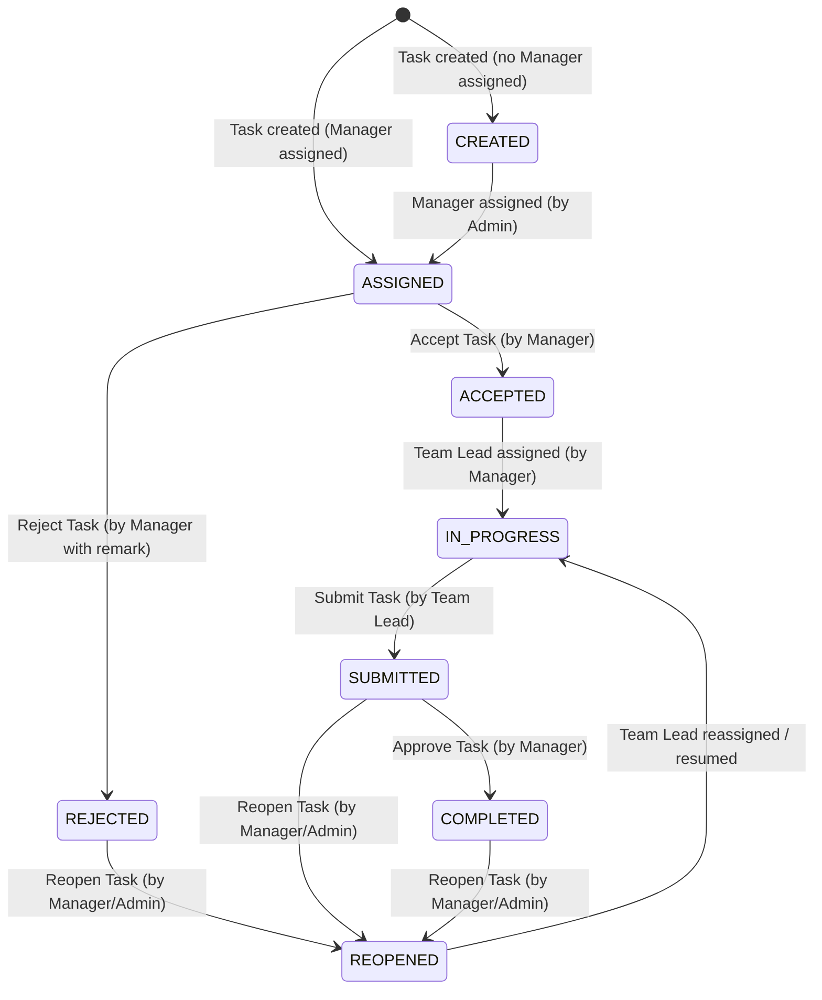
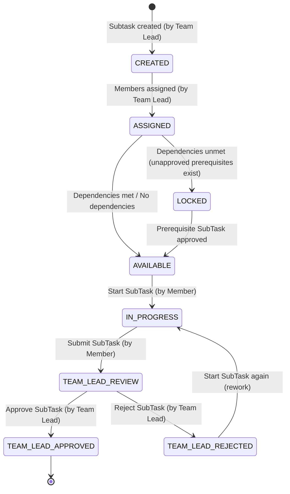
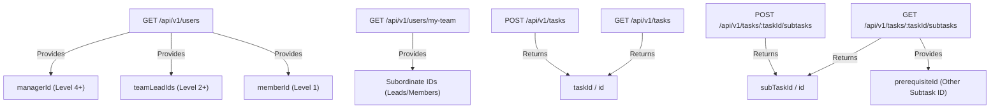

# Task & SubTask Module: Complete API Documentation & Integration Guide

Welcome to the Task and SubTask Management integration guide. This document provides frontend developers with a complete blueprint of the endpoint specifications, lifecycle state machines, role permissions, dependency systems, and step-by-step integration flows.

---

## 1. Flow Diagrams & State Machines

### A. Task Lifecycle State Machine


### B. SubTask Lifecycle & Dependency Unlock Flow


---

## 2. Access Control Matrix (Role Levels)

The Wiftil platform uses a numerical access level hierarchy (1–5). Below is the access matrix showing who can call which API:

| Level | Role Name | Allowed Task Actions | Allowed SubTask Actions |
| :--- | :--- | :--- | :--- |
| **Level 5** | **BOSS (Admin)** | Create, View, Update, Delete, Assign Manager, Reopen | View, Manage (as Team Lead fallback) |
| **Level 4** | **MANAGER** | View, Accept, Reject, Assign Leads, Approve, Reopen | View, Manage (if admin fallback needed) |
| **Level 3** | **SUPERVISOR** | View | View |
| **Level 2** | **LEADER (Team Lead)** | View (if assigned), Submit Task | Create, Update, Delete, Assign Member, Approve/Reject Subtask, Manage Dependencies |
| **Level 1** | **EMPLOYEE (Member)** | View (if assigned to a subtask) | View (assigned only), Start, Submit Subtask |

---

## 3. ID Relationship Guide: How to Retrieve Referenced IDs

Frontend developers often need identifiers (UUIDs) of users, tasks, and subtasks to execute requests. Below is a map explaining exactly which APIs return these IDs.



### Reference Table:

| ID Parameter Name | Where is it used? | How does the frontend get it? |
| :--- | :--- | :--- |
| `managerId` | `POST /api/v1/tasks` (Create)<br>`POST /api/v1/tasks/:id/assign-manager` | Call `GET /api/v1/users` and filter/look for users with role access level **4** (`MANAGER`). |
| `teamLeadIds` | `POST /api/v1/tasks/:id/assign-leads` | Call `GET /api/v1/users` or `GET /api/v1/users/my-team` and select users with role access level **2** (`LEADER`) or **3** (`SUPERVISOR`). |
| `memberId` | `POST /api/v1/tasks/:taskId/subtasks/:id/assign` | Call `GET /api/v1/users` or `GET /api/v1/users/my-team` and select users with role access level **1** (`EMPLOYEE`). |
| `taskId` / `id` | All Task CRUD & workflow paths | Returned in the response payload of `POST /api/v1/tasks` or via `GET /api/v1/tasks`. |
| `subTaskId` / `id` | All SubTask CRUD & workflow paths | Returned in the response payload of `POST /api/v1/tasks/:taskId/subtasks` or via `GET /api/v1/tasks/:taskId/subtasks`. |
| `prerequisiteId` | `POST /api/v1/tasks/:taskId/subtasks/:id/dependencies` | Fetch the list of existing subtasks via `GET /api/v1/tasks/:taskId/subtasks` and select the ID of the subtask that must be completed first. |

---

## 4. Task API Reference

> [!IMPORTANT]
> All requests must include the HTTP header `Authorization: Bearer <JWT_TOKEN>`.

### A. Stats & Dashboard
#### Get Task Statistics (`GET /api/v1/tasks/stats`)
- **Access Level**: All logged-in users (Results scoped by role: Admins see all, Managers see managed tasks).
- **Description**: Returns count of tasks grouped by status and count of overdue tasks.
- **cURL Request**:
```bash
curl -X GET "http://localhost:5000/api/v1/tasks/stats" \
  -H "Authorization: Bearer YOUR_JWT_TOKEN"
```
- **Success Response (200 OK)**:
```json
{
  "success": true,
  "data": {
    "stats": {
      "total": 12,
      "overdue": 2,
      "byStatus": [
        { "status": "IN_PROGRESS", "count": 5 },
        { "status": "COMPLETED", "count": 4 },
        { "status": "ASSIGNED", "count": 3 }
      ]
    }
  }
}
```

---

### B. Task CRUD Operations

#### Create a Task (`POST /api/v1/tasks`)
- **Access Level**: Level 5 (Admin/BOSS)
- **Description**: Registers a new high-level task. If `managerId` is provided, status is set to `ASSIGNED` and a notification is sent to the manager. Otherwise, status is `CREATED`.
- **Request Body Parameters**:
  - `title` (string, Required)
  - `description` (string, Optional)
  - `priority` (string: `LOW` \| `MEDIUM` \| `HIGH` \| `CRITICAL`, Optional, default: `MEDIUM`)
  - `startDate` (string "YYYY-MM-DD", Optional)
  - `dueDate` (string "YYYY-MM-DD", Optional)
  - `estimatedHours` (number, Optional)
  - `managerId` (UUID, Optional)
- **cURL Request**:
```bash
curl -X POST "http://localhost:5000/api/v1/tasks" \
  -H "Authorization: Bearer YOUR_JWT_TOKEN" \
  -H "Content-Type: application/json" \
  -d '{
    "title": "Migrate Database to Production",
    "description": "Refactor all migrations and seeders for production MySQL deployment",
    "priority": "HIGH",
    "startDate": "2026-06-21",
    "dueDate": "2026-06-30",
    "estimatedHours": 45.5,
    "managerId": "4a081a28-98e3-4c91-9cb6-a67b8dcf2029"
  }'
```
- **Success Response (201 Created)**:
```json
{
  "success": true,
  "message": "Task created",
  "data": {
    "task": {
      "id": "e6a2b8e3-cf85-48b4-9694-82a15c8e1124",
      "title": "Migrate Database to Production",
      "description": "Refactor all migrations and seeders for production MySQL deployment",
      "priority": "HIGH",
      "status": "ASSIGNED",
      "startDate": "2026-06-21",
      "dueDate": "2026-06-30",
      "estimatedHours": 45.5,
      "actualHours": 0,
      "completionPercent": 0,
      "createdById": "50c8fa28-cf1c-4876-b631-f513d8d21a22",
      "managerId": "4a081a28-98e3-4c91-9cb6-a67b8dcf2029",
      "managerRemark": null,
      "managerActionAt": null,
      "submittedAt": null,
      "approvedAt": null,
      "completedAt": null,
      "createdAt": "2026-06-20T15:00:00.000Z",
      "updatedAt": "2026-06-20T15:00:00.000Z"
    }
  }
}
```

#### Get All Tasks (`GET /api/v1/tasks`)
- **Access Level**: All authenticated users (Role-scoped access: Admins see all; Managers see tasks they manage; Team Leads see tasks they are assigned to; Members see tasks containing subtasks they are assigned to).
- **Query Parameters**:
  - `page` (number, default: 1)
  - `limit` (number, default: 20)
  - `status` (string, Optional filter)
  - `priority` (string, Optional filter)
  - `search` (string, Optional title/description match)
- **cURL Request**:
```bash
curl -X GET "http://localhost:5000/api/v1/tasks?page=1&limit=10&status=IN_PROGRESS" \
  -H "Authorization: Bearer YOUR_JWT_TOKEN"
```
- **Success Response (200 OK)**:
```json
{
  "success": true,
  "message": "Tasks fetched",
  "data": [
    {
      "id": "e6a2b8e3-cf85-48b4-9694-82a15c8e1124",
      "title": "Migrate Database to Production",
      "status": "IN_PROGRESS",
      "priority": "HIGH",
      "dueDate": "2026-06-30",
      "completionPercent": 35.5,
      "manager": {
        "id": "4a081a28-98e3-4c91-9cb6-a67b8dcf2029",
        "firstName": "John",
        "lastName": "Doe",
        "email": "john.doe@wiftil.com"
      }
    }
  ],
  "meta": {
    "total": 1,
    "page": 1,
    "limit": 10
  }
}
```

#### Get Task By ID (`GET /api/v1/tasks/:id`)
- **Access Level**: All (Role-scoped visibility check)
- **Description**: Returns full task details, including nested list of SubTasks, their assignments, and their prerequisite dependencies.
- **cURL Request**:
```bash
curl -X GET "http://localhost:5000/api/v1/tasks/e6a2b8e3-cf85-48b4-9694-82a15c8e1124" \
  -H "Authorization: Bearer YOUR_JWT_TOKEN"
```
- **Success Response (200 OK)**:
```json
{
  "success": true,
  "data": {
    "task": {
      "id": "e6a2b8e3-cf85-48b4-9694-82a15c8e1124",
      "title": "Migrate Database to Production",
      "status": "IN_PROGRESS",
      "subTasks": [
        {
          "id": "f8a1a9e8-45cf-4235-86ba-c6a85f8c8571",
          "title": "Write Schema Migrations",
          "status": "TEAM_LEAD_APPROVED",
          "assignments": [
            {
              "member": {
                "id": "11ab9c21-89e4-4cbb-bb94-f6b8dfcb0011",
                "firstName": "Alice",
                "lastName": "Smith"
              }
            }
          ]
        }
      ]
    }
  }
}
```

#### Update Task (`PATCH /api/v1/tasks/:id`)
- **Access Level**: Level 5 (Admin/BOSS)
- **Description**: Updates high-level fields. Only works for tasks that exist and are not deleted.
- **Request Body Parameters** (all optional):
  - `title`
  - `description`
  - `priority`
  - `startDate`
  - `dueDate`
  - `estimatedHours`
- **cURL Request**:
```bash
curl -X PATCH "http://localhost:5000/api/v1/tasks/e6a2b8e3-cf85-48b4-9694-82a15c8e1124" \
  -H "Authorization: Bearer YOUR_JWT_TOKEN" \
  -H "Content-Type: application/json" \
  -d '{
    "title": "Production DB Migration & Seeding",
    "priority": "CRITICAL"
  }'
```

#### Delete Task (`DELETE /api/v1/tasks/:id`)
- **Access Level**: Level 5 (Admin/BOSS)
- **Description**: Soft deletes the task by setting the `deleted_at` field.
- **cURL Request**:
```bash
curl -X DELETE "http://localhost:5000/api/v1/tasks/e6a2b8e3-cf85-48b4-9694-82a15c8e1124" \
  -H "Authorization: Bearer YOUR_JWT_TOKEN"
```
- **Success Response (200 OK)**:
```json
{
  "success": true,
  "message": "Task deleted"
}
```

---

### C. Task Workflow Transitions

#### Assign Manager (`POST /api/v1/tasks/:id/assign-manager`)
- **Access Level**: Level 5 (Admin)
- **Description**: Associates a Manager with a task and updates the status to `ASSIGNED`.
- **Request Body**:
  - `managerId` (UUID, Required)
- **cURL Request**:
```bash
curl -X POST "http://localhost:5000/api/v1/tasks/e6a2b8e3-cf85-48b4-9694-82a15c8e1124/assign-manager" \
  -H "Authorization: Bearer YOUR_JWT_TOKEN" \
  -H "Content-Type: application/json" \
  -d '{ "managerId": "4a081a28-98e3-4c91-9cb6-a67b8dcf2029" }'
```

#### Accept Task (`POST /api/v1/tasks/:id/accept`)
- **Access Level**: Level 4 (Assigned Manager)
- **Description**: Allows the assigned manager to accept the task. Status must be `ASSIGNED`. Updates status to `ACCEPTED`.
- **Request Body**:
  - `remark` (string, Optional)
- **cURL Request**:
```bash
curl -X POST "http://localhost:5000/api/v1/tasks/e6a2b8e3-cf85-48b4-9694-82a15c8e1124/accept" \
  -H "Authorization: Bearer YOUR_JWT_TOKEN" \
  -H "Content-Type: application/json" \
  -d '{ "remark": "Resource allocation confirmed. Ready to start." }'
```

#### Reject Task (`POST /api/v1/tasks/:id/reject`)
- **Access Level**: Level 4 (Assigned Manager)
- **Description**: Allows the manager to reject a task. Status must be `ASSIGNED`. Requires a comment/remark. Updates status to `REJECTED`.
- **Request Body**:
  - `remark` (string, Required)
- **cURL Request**:
```bash
curl -X POST "http://localhost:5000/api/v1/tasks/e6a2b8e3-cf85-48b4-9694-82a15c8e1124/reject" \
  -H "Authorization: Bearer YOUR_JWT_TOKEN" \
  -H "Content-Type: application/json" \
  -d '{ "remark": "Insufficient timeline. Need at least 2 more weeks." }'
```

#### Assign Team Leads (`POST /api/v1/tasks/:id/assign-leads`)
- **Access Level**: Level 4 (Assigned Manager)
- **Description**: Manager delegates the task to one or multiple Team Leads. Transitions task status to `IN_PROGRESS`.
- **Request Body**:
  - `teamLeadIds` (array of UUID strings, Required)
- **cURL Request**:
```bash
curl -X POST "http://localhost:5000/api/v1/tasks/e6a2b8e3-cf85-48b4-9694-82a15c8e1124/assign-leads" \
  -H "Authorization: Bearer YOUR_JWT_TOKEN" \
  -H "Content-Type: application/json" \
  -d '{
    "teamLeadIds": [
      "123ab456-cd78-ef90-1234-567890abcdef"
    ]
  }'
```

#### Submit Task for Approval (`POST /api/v1/tasks/:id/submit`)
- **Access Level**: Level 2 (Assigned Team Lead)
- **Description**: Team Lead submits the overall task to the Manager. Checks that **all subtasks** are approved (`TEAM_LEAD_APPROVED` or `FINAL_APPROVED`). If any subtask is incomplete or rejected, a conflict (409) is returned. Updates task status to `SUBMITTED`.
- **cURL Request**:
```bash
curl -X POST "http://localhost:5000/api/v1/tasks/e6a2b8e3-cf85-48b4-9694-82a15c8e1124/submit" \
  -H "Authorization: Bearer YOUR_JWT_TOKEN"
```

#### Approve Task (`POST /api/v1/tasks/:id/approve`)
- **Access Level**: Level 4 (Assigned Manager)
- **Description**: Final approval of the task. Updates task status to `COMPLETED`.
- **Request Body**:
  - `remark` (string, Optional)
- **cURL Request**:
```bash
curl -X POST "http://localhost:5000/api/v1/tasks/e6a2b8e3-cf85-48b4-9694-82a15c8e1124/approve" \
  -H "Authorization: Bearer YOUR_JWT_TOKEN" \
  -H "Content-Type: application/json" \
  -d '{ "remark": "Excellent work. The migration was successful without downtime." }'
```

#### Reopen Task (`POST /api/v1/tasks/:id/reopen`)
- **Access Level**: Level 4 (Manager / Admin)
- **Description**: Reopens a completed, submitted, or rejected task. Transitions status to `REOPENED`.
- **Request Body**:
  - `remark` (string, Optional)
- **cURL Request**:
```bash
curl -X POST "http://localhost:5000/api/v1/tasks/e6a2b8e3-cf85-48b4-9694-82a15c8e1124/reopen" \
  -H "Authorization: Bearer YOUR_JWT_TOKEN" \
  -H "Content-Type: application/json" \
  -d '{ "remark": "Seeding script has a syntax issue, please fix and resubmit." }'
```

---

## 5. SubTask API Reference

> [!NOTE]
> All SubTask endpoints are nested under the parent task ID: `/api/v1/tasks/:taskId/subtasks`.

### A. SubTask CRUD Operations

#### Create a SubTask (`POST /api/v1/tasks/:taskId/subtasks`)
- **Access Level**: Level 2 (Assigned Team Lead)
- **Description**: Creates a new subtask under a task. The parent task must be in `ACCEPTED`, `IN_PROGRESS`, or `REOPENED` status.
- **Request Body Parameters**:
  - `title` (string, Required)
  - `description` (string, Optional)
  - `priority` (string: `LOW` \| `MEDIUM` \| `HIGH` \| `CRITICAL`, Optional, default: `MEDIUM`)
  - `startDate` (string "YYYY-MM-DD", Optional)
  - `dueDate` (string "YYYY-MM-DD", Optional)
  - `estimatedHours` (number, Optional)
- **cURL Request**:
```bash
curl -X POST "http://localhost:5000/api/v1/tasks/e6a2b8e3-cf85-48b4-9694-82a15c8e1124/subtasks" \
  -H "Authorization: Bearer YOUR_JWT_TOKEN" \
  -H "Content-Type: application/json" \
  -d '{
    "title": "Write Seeding Script",
    "description": "Create seeds for roles, baseline settings, and test admin credentials",
    "priority": "MEDIUM",
    "startDate": "2026-06-22",
    "dueDate": "2026-06-25",
    "estimatedHours": 10.0
  }'
```

#### Get All SubTasks of a Task (`GET /api/v1/tasks/:taskId/subtasks`)
- **Access Level**: All authenticated users (scoped: Members only see subtasks they are assigned to).
- **Query Filters**:
  - `status` (string, Optional status filter)
- **cURL Request**:
```bash
curl -X GET "http://localhost:5000/api/v1/tasks/e6a2b8e3-cf85-48b4-9694-82a15c8e1124/subtasks" \
  -H "Authorization: Bearer YOUR_JWT_TOKEN"
```

#### Get SubTask By ID (`GET /api/v1/tasks/:taskId/subtasks/:id`)
- **Access Level**: All authenticated users (visibility rules apply).
- **cURL Request**:
```bash
curl -X GET "http://localhost:5000/api/v1/tasks/e6a2b8e3-cf85-48b4-9694-82a15c8e1124/subtasks/f8a1a9e8-45cf-4235-86ba-c6a85f8c8571" \
  -H "Authorization: Bearer YOUR_JWT_TOKEN"
```

#### Update SubTask (`PATCH /api/v1/tasks/:taskId/subtasks/:id`)
- **Access Level**: Level 2 (Assigned Team Lead)
- **Description**: Updates subtask details. Only works if subtask status is `CREATED`, `ASSIGNED`, `LOCKED`, or `AVAILABLE`. Cannot edit a subtask that has already been started or completed.
- **Request Body Parameters** (all optional):
  - `title`
  - `description`
  - `priority`
  - `startDate`
  - `dueDate`
  - `estimatedHours`
- **cURL Request**:
```bash
curl -X PATCH "http://localhost:5000/api/v1/tasks/e6a2b8e3-cf85-48b4-9694-82a15c8e1124/subtasks/f8a1a9e8-45cf-4235-86ba-c6a85f8c8571" \
  -H "Authorization: Bearer YOUR_JWT_TOKEN" \
  -H "Content-Type: application/json" \
  -d '{ "title": "Write Seeding Script v2", "estimatedHours": 12.0 }'
```

#### Delete SubTask (`DELETE /api/v1/tasks/:taskId/subtasks/:id`)
- **Access Level**: Level 2 (Assigned Team Lead)
- **Description**: Permanently deletes a subtask. Only allowed if status is `CREATED`, `ASSIGNED`, `LOCKED`, or `AVAILABLE` (i.e. not yet started).
- **cURL Request**:
```bash
curl -X DELETE "http://localhost:5000/api/v1/tasks/e6a2b8e3-cf85-48b4-9694-82a15c8e1124/subtasks/f8a1a9e8-45cf-4235-86ba-c6a85f8c8571" \
  -H "Authorization: Bearer YOUR_JWT_TOKEN"
```

---

### B. SubTask Assignment & Workflow

#### Assign SubTask (`POST /api/v1/tasks/:taskId/subtasks/:id/assign`)
- **Access Level**: Level 2 (Assigned Team Lead)
- **Description**: Assigns one or more members to a subtask with percentage contribution (must equal 100% in aggregate). If dependencies are unmet, status transitions to `LOCKED`; otherwise, it transitions to `AVAILABLE`.
- **Request Body**:
  - `assignments` (array of objects, Required)
    - `memberId` (UUID, Required)
    - `contribution` (number 0-100, Required)
- **cURL Request**:
```bash
curl -X POST "http://localhost:5000/api/v1/tasks/e6a2b8e3-cf85-48b4-9694-82a15c8e1124/subtasks/f8a1a9e8-45cf-4235-86ba-c6a85f8c8571/assign" \
  -H "Authorization: Bearer YOUR_JWT_TOKEN" \
  -H "Content-Type: application/json" \
  -d '{
    "assignments": [
      { "memberId": "11ab9c21-89e4-4cbb-bb94-f6b8dfcb0011", "contribution": 60 },
      { "memberId": "aa92b118-29ef-4c12-bbf6-e17f8a9202bf", "contribution": 40 }
    ]
  }'
```

#### Start SubTask (`PATCH /api/v1/tasks/:taskId/subtasks/:id/start`)
- **Access Level**: Level 1 (Assigned Member)
- **Description**: Allows the assigned worker to begin. Status must be `AVAILABLE`, `ASSIGNED`, or `REOPENED`. Updates status to `IN_PROGRESS` and sets `startedAt`.
- **cURL Request**:
```bash
curl -X PATCH "http://localhost:5000/api/v1/tasks/e6a2b8e3-cf85-48b4-9694-82a15c8e1124/subtasks/f8a1a9e8-45cf-4235-86ba-c6a85f8c8571/start" \
  -H "Authorization: Bearer YOUR_JWT_TOKEN"
```

#### Submit SubTask (`POST /api/v1/tasks/:taskId/subtasks/:id/submit`)
- **Access Level**: Level 1 (Assigned Member)
- **Description**: Member submits the subtask for Team Lead review. Updates status to `TEAM_LEAD_REVIEW`.
- **Request Body**:
  - `actualHours` (number, Optional actual time spent)
- **cURL Request**:
```bash
curl -X POST "http://localhost:5000/api/v1/tasks/e6a2b8e3-cf85-48b4-9694-82a15c8e1124/subtasks/f8a1a9e8-45cf-4235-86ba-c6a85f8c8571/submit" \
  -H "Authorization: Bearer YOUR_JWT_TOKEN" \
  -H "Content-Type: application/json" \
  -d '{ "actualHours": 9.5 }'
```

#### Approve SubTask (`POST /api/v1/tasks/:taskId/subtasks/:id/approve`)
- **Access Level**: Level 2 (Assigned Team Lead)
- **Description**: Team Lead approves the subtask. Status becomes `TEAM_LEAD_APPROVED`.
  - Recalculates the parent task's completion percentage.
  - Automatically unlocks any dependent subtasks (locks changed to `AVAILABLE` if all their prerequisites are now approved).
- **Request Body**:
  - `comment` (string, Optional)
- **cURL Request**:
```bash
curl -X POST "http://localhost:5000/api/v1/tasks/e6a2b8e3-cf85-48b4-9694-82a15c8e1124/subtasks/f8a1a9e8-45cf-4235-86ba-c6a85f8c8571/approve" \
  -H "Authorization: Bearer YOUR_JWT_TOKEN" \
  -H "Content-Type: application/json" \
  -d '{ "comment": "Code verified, clean structure and passes test cases." }'
```

#### Reject SubTask (`POST /api/v1/tasks/:taskId/subtasks/:id/reject`)
- **Access Level**: Level 2 (Assigned Team Lead)
- **Description**: Rejects the subtask. Status becomes `TEAM_LEAD_REJECTED`. The member will need to rework and submit again.
- **Request Body**:
  - `comment` (string, Required)
- **cURL Request**:
```bash
curl -X POST "http://localhost:5000/api/v1/tasks/e6a2b8e3-cf85-48b4-9694-82a15c8e1124/subtasks/f8a1a9e8-45cf-4235-86ba-c6a85f8c8571/reject" \
  -H "Authorization: Bearer YOUR_JWT_TOKEN" \
  -H "Content-Type: application/json" \
  -d '{ "comment": "Please add unit tests for the role seeder logic before approval." }'
```

---

### C. Dependency Management

#### Add Dependency (`POST /api/v1/tasks/:taskId/subtasks/:id/dependencies`)
- **Access Level**: Level 2 (Assigned Team Lead)
- **Description**: Declares that subtask `:id` depends on `prerequisiteId` being approved before it can start. Validates that no circular reference is created. If prerequisite is not yet approved, status of the subtask is set to `LOCKED`.
- **Request Body**:
  - `prerequisiteId` (UUID string, Required)
- **cURL Request**:
```bash
curl -X POST "http://localhost:5000/api/v1/tasks/e6a2b8e3-cf85-48b4-9694-82a15c8e1124/subtasks/f8a1a9e8-45cf-4235-86ba-c6a85f8c8571/dependencies" \
  -H "Authorization: Bearer YOUR_JWT_TOKEN" \
  -H "Content-Type: application/json" \
  -d '{ "prerequisiteId": "dd901b22-83b4-4b5c-b172-e8f0a29efbca" }'
```

#### Remove Dependency (`DELETE /api/v1/tasks/:taskId/subtasks/:id/dependencies/:prerequisiteId`)
- **Access Level**: Level 2 (Assigned Team Lead)
- **Description**: Removes a dependency. If no other unmet prerequisites remain, sets subtask status to `AVAILABLE`.
- **cURL Request**:
```bash
curl -X DELETE "http://localhost:5000/api/v1/tasks/e6a2b8e3-cf85-48b4-9694-82a15c8e1124/subtasks/f8a1a9e8-45cf-4235-86ba-c6a85f8c8571/dependencies/dd901b22-83b4-4b5c-b172-e8f0a29efbca" \
  -H "Authorization: Bearer YOUR_JWT_TOKEN"
```

---

## 6. Comprehensive Lifecycle Walkthrough

To help frontend developers understand how these endpoints coordinate in practice, here is a step-by-step end-to-end flow:

### Phase 1: Task Initialization (Admin)
1. Admin logs in, gets JWT Token.
2. Admin fetches list of managers using `GET /api/v1/users` (looking for role level 4).
3. Admin creates a Task assigning the manager's ID to `managerId`:
   - Endpoint: `POST /api/v1/tasks`
   - Task status transitions to: **`ASSIGNED`**.

### Phase 2: Manager Review (Manager)
1. Manager logs in, fetches their assigned tasks using `GET /api/v1/tasks?status=ASSIGNED`.
2. Manager accepts the task:
   - Endpoint: `POST /api/v1/tasks/:id/accept`
   - Task status transitions to: **`ACCEPTED`**.
3. Manager fetches available Team Leads (Level 2) using `GET /api/v1/users`.
4. Manager assigns the task to one or more Team Leads:
   - Endpoint: `POST /api/v1/tasks/:id/assign-leads`
   - Task status transitions to: **`IN_PROGRESS`**.

### Phase 3: SubTask Creation & Assignments (Team Lead)
1. Assigned Team Lead fetches tasks using `GET /api/v1/tasks`.
2. Team Lead creates subtasks under this parent task:
   - Endpoint: `POST /api/v1/tasks/:taskId/subtasks`
   - SubTask status starts as: **`CREATED`**.
3. Team Lead defines dependencies if subtasks must be executed in order:
   - Endpoint: `POST /api/v1/tasks/:taskId/subtasks/:id/dependencies`
4. Team Lead fetches available members (Level 1) using `GET /api/v1/users`.
5. Team Lead assigns members to the subtasks:
   - Endpoint: `POST /api/v1/tasks/:taskId/subtasks/:id/assign`
   - If a subtask has unmet dependencies, status transitions to **`LOCKED`**.
   - If it has no dependencies or all prerequisites are approved, status transitions to **`AVAILABLE`**.

### Phase 4: SubTask Execution & Approvals (Member & Lead)
1. Assigned Member fetches their assigned subtasks using `GET /api/v1/tasks/:taskId/subtasks`.
2. Member starts the subtask:
   - Endpoint: `PATCH /api/v1/tasks/:taskId/subtasks/:id/start`
   - SubTask status transitions to: **`IN_PROGRESS`**.
3. Member finishes work, and submits:
   - Endpoint: `POST /api/v1/tasks/:taskId/subtasks/:id/submit`
   - SubTask status transitions to: **`TEAM_LEAD_REVIEW`**.
4. Team Lead reviews, and approves:
   - Endpoint: `POST /api/v1/tasks/:taskId/subtasks/:id/approve`
   - SubTask status transitions to: **`TEAM_LEAD_APPROVED`**.
   - Parent Task completion percentage is automatically re-calculated.
   - Any dependent subtask that was `LOCKED` transitions to `AVAILABLE` automatically.

### Phase 5: Task Submission & Completion (Team Lead & Manager)
1. Once all subtasks are approved (all status are `TEAM_LEAD_APPROVED`), the Team Lead submits the main task:
   - Endpoint: `POST /api/v1/tasks/:id/submit`
   - Task status transitions to: **`SUBMITTED`**.
2. Manager reviews the completed work, and approves it:
   - Endpoint: `POST /api/v1/tasks/:id/approve`
   - Task status transitions to: **`COMPLETED`**.
